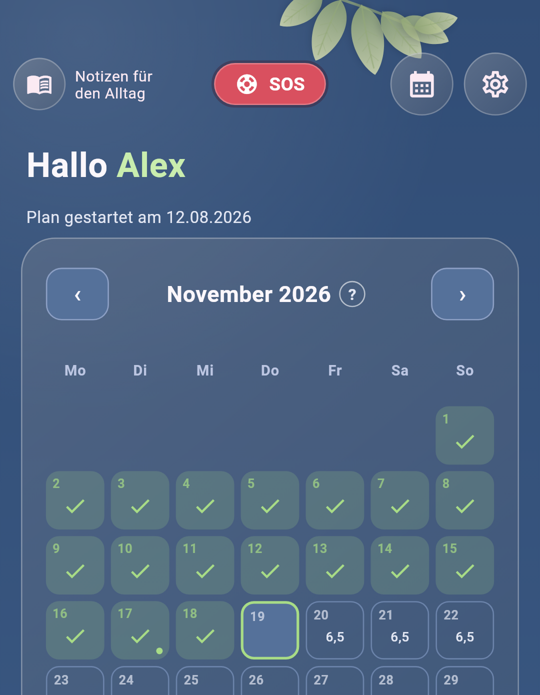
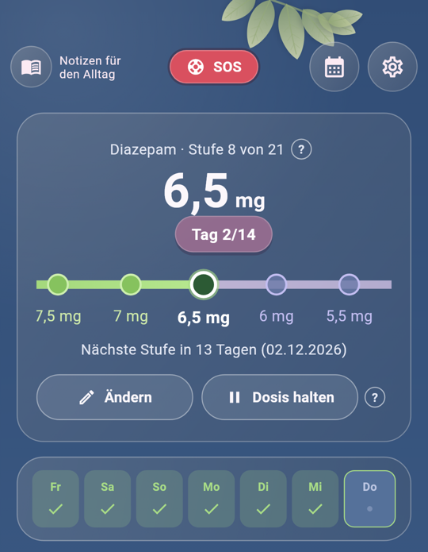

# BeNzoTaPer

[🇬🇧 English](README.md) · **🇩🇪 Deutsch**

**Begleiter zum Abdosieren von Benzodiazepinen – für Android, offline, ohne Konto.**

*Die App gibt es auf Deutsch und Englisch (Sprachwahl beim ersten Start, später unter „Mehr“). The app is available in German and English – you choose the language when you first open it.*

BeNzoTaPer hält dich auf deinem Reduktionsplan auf Linie: Er zeigt jeden Tag, welche Dosis dran ist, zählt die geschafften Tage, passt den Plan an, wenn du eine Dosis länger hältst, und sagt dir rechtzeitig, wann der Tablettenvorrat knapp wird. Gedacht ist er für alle, die beim Abdosieren keine enge ärztliche Begleitung haben, und für alle, die einfach einen klaren Überblick wollen.

> **Wichtig:** BeNzoTaPer ist ein Werkzeug zum Organisieren und Dokumentieren. Er ersetzt keine ärztliche Beratung, stellt keine Diagnosen und entscheidet nicht über Dosis oder Tempo. Den Plan stimmst du mit einer medizinischen Fachperson ab. Benzodiazepine nach längerer Einnahme nie abrupt absetzen. Bei Krampfanfall, starker Verwirrtheit oder anderen akuten Problemen: **112**.

<p align="center">
  
  
</p>
<p align="center"><sub>Bilder mit Testdaten (Name „Alex“, Diazepam 10 → 0 mg).</sub></p>

---

## Inhalt
- [Die Idee dahinter](#die-idee-dahinter)
- [Was die App kann](#was-die-app-kann)
- [Die Regeln, nach denen sie rechnet](#die-regeln-nach-denen-sie-rechnet)
- [Daten und Datenschutz](#daten-und-datenschutz)
- [Installation](#installation)
- [Für Entwickler](#für-entwickler)

---

## Die Idee dahinter

- **Fortschritt statt Symptomjagd.** Im Mittelpunkt steht der Weg, den du schon geschafft hast, und nicht das tägliche Absuchen nach Entzugssymptomen.
- **Die App rät nichts.** Ein Tag ohne Eintrag bleibt ein Fragezeichen. Er zählt nie als „wie geplant“ und nie als 0 mg. Einzige Ausnahme ist der Vorrat: Dort zählt er mit der geplanten Dosis, als Schätzung gekennzeichnet, bis du nachträgst – sonst wäre der Vorrat schneller leer, als die App sagt.
- **Bremse ohne Bevormundung.** Schneller reduzieren geht sofort. Hochgehen oder langsamer werden geht auch – nach einem kurzen Innehalten.
- **Der Vorrat ist wichtig.** Ärzte machen manchmal ohne Vorwarnung dicht. Mit einem Puffer hast du Zeit, eine Lösung zu finden.
- **Schlicht.** Keine Prozente, keine Punkte, keine Belohnungsspielchen, nichts, was man bedienen *muss*.

## Was die App kann

### Heute (Startseite)
- **Einnahme:** ein Knopf, Menge eingeben, OK. Die Uhrzeit kommt automatisch (so steht sie auch im Arztbericht). Bis zur geplanten Dosis gibt es ein Häkchen, darüber erst ein kurzes Innehalten.
- Aktuelle Stufe und Dosis, Tag x von y, nächste Stufe, dazu die passende **Tablettenkombination** (z. B. aus 5-mg- und 2-mg-Tabletten).
- **Plan anpassen** (ab heute Dosis, Tage und Stufen ändern, gilt sofort) und **Dosis halten** (mit oder ohne Enddatum, der Plan verschiebt sich automatisch).
- Wochenstreifen der letzten 7 Tage.
- **Lob beim Halten:** Wer eine Dosis hält, bekommt alle paar Tage eine kurze Bestätigung, aber nur für saubere Tage. Das Lob ist als Vorbeugung gedacht, nicht als Belohnung.
- **Tablettenvorrat:** Anzahl × Stärke eintragen, die App rechnet in mg um und sagt, wie lange es beim aktuellen Plan reicht („Keine exakte Angabe garantiert – zu viele Variablen, aber ziemlich genau.“). Jede Einnahme wird automatisch abgezogen, Tage ohne Eintrag zählen mit der geplanten Dosis. Nachkäufe lassen sich dazurechnen. Teilbare Tabletten und Lösungen (mg/ml) werden berücksichtigt.
- Dezente Erinnerung, wenn länger nicht gesichert wurde.

### Kalender
- Monatsansicht mit Häkchen für jeden Tag im Plan, Zahlen für mehr Genommenes, die geplante Dosis an kommenden Tagen, **?** für Tage ohne Eintrag, einem Strich bei jeder neuen Stufe, einer Sonne für gute Tage und einem Punkt für Notizen.
- **Voraussichtlich bei 0 mg: TT.MM.JJJJ.** Das Datum rechnet sich jeden Tag neu, denn ein fester Termin setzt nur unter Druck.
- Tag antippen: nachtragen (bis 7 Tage zurück) oder eine Notiz schreiben.
- **Wochen-Durchschnitt** der letzten 4 Wochen und ein **Live-Durchschnitt seit Stufenbeginn**, der sich mit jedem Eintrag sofort ändert. Der Durchschnitt zeigt, wie wenig ein einzelner Ausrutscher am Gesamtbild ändert.
- **Notizen für heute** mit Smileys für das Befinden. Gedacht für Mustererkennung im Nachhinein (Koffein, Vapen, neue Medikamente …), nicht als Symptomtagebuch.

### Plan
- **Plan erstellen** als Fragebogen: Abschnitte wie „von 10 mg bis 5 mg, 1 mg alle 14 Tage“, danach langsamer und so weiter. Startdatum wählbar.
- **Plan importieren** aus PDF, Word (.docx) oder Text, zum Beispiel aus einem Plan vom Arzt.
- Erstellen und Importieren gibt es nur ohne eigenen Plan. Läuft ein Plan, wird er mit **Plan anpassen** geändert. **Ganz neu anfangen** geht über Mehr → Zurücksetzen (wie eine neu installierte App, vorher sichern).
- Stufenliste mit erledigten, aktuellen und kommenden Stufen.

### Fortschritt
- **Dein Weg:** von wie viel auf wie viel mg, geschaffte Tage, Stufe x von n, voraussichtliches Ende.
- **Verlauf** als Diagramm: der Plan als Treppe, der 7-Tage-Durchschnitt als Welle, rote Punkte an Tagen über Plan.
- **Diagramm für den Arzt:** dasselbe Diagramm als PDF zum Teilen oder zum Anschauen in groß („Lesen“).
- **Verlaufsbericht für den Arzt:** Übersicht, Stufen, Planänderungen, Wochen-Durchschnitte und Tagesprotokoll mit Uhrzeiten, als PDF (ohne Notizen).

### Immer erreichbar
- **SOS** (rot, oben in der Mitte): ein 15-Minuten-Timer, um eine Welle auszusitzen, ein Atemkreis (4 Sekunden ein, 6 aus), „Was du schon geschafft hast“ sowie Notruf 112 und (in der deutschen Fassung) die Telefonseelsorge 0800 111 0 111.
- **Kurz innehalten:** Wer mehr eintragen will als geplant, bekommt zuerst einen kurzen Halt angeboten. Danach geht es ganz normal weiter.
- **Notizbuch** (oben links) für Gedanken und Alltägliches, unabhängig vom Kalender.

### Einstellungen („Mehr“)
- **PIN-Sperre** mit Schlüsselwort für „PIN vergessen?“ (die PIN sperrt nur die Oberfläche).
- **Erinnerung zum Eintragen** (standardmäßig aus, Uhrzeit einstellbar).
- **Vorrat-Hinweis** als Benachrichtigung, wenn der Vorrat noch 14 und noch 7 Tage reicht (um 10 Uhr, sobald ein Vorrat eingetragen ist).
- **Verschlüsselte Sicherung** speichern und laden, etwa für ein neues Handy. Sie enthält den ganzen Abdosierverlauf (Plan, alle Einträge mit Uhrzeit, Vorrat, Notizen, Notizbuch), aber nichts von der App selbst: PIN, Schlüsselwort und Einstellungen bleiben auf dem Gerät.
- Anleitung, alle Hinweise nochmal lesen, alles zurücksetzen.

Ohne eigenen Plan zeigt die App einen **Beispielplan**, damit man sieht, wie alles aussieht. Das Beispiel wird nie gespeichert.

### Geplant
- **Rückwirkende Eintragungen für bereits laufende Abdosierungen.** Wer schon mitten im Abdosieren ist (zum Beispiel mit einer Strichliste auf Papier), soll einen Plan mit Startdatum in der Vergangenheit anlegen und seinen bisherigen Verlauf nachträglich eintragen oder als Liste importieren können. Wochen-Durchschnitt und Verlauf werden dann automatisch nachberechnet. Nachgetragene Tage bekommen im Kalender ein kleines Symbol und zählen nicht für das Lob.

## Die Regeln, nach denen sie rechnet

| Situation | Was passiert |
|---|---|
| Tag ohne Eintrag | Bleibt **?**. Anzeigen pausieren, der Plan verschiebt sich **nicht**. Nachtragen geht bis 7 Tage zurück, ältere Tage bekommen „Weiß ich nicht mehr“. |
| Mehr genommen als geplant | Wird dokumentiert. Am nächsten Tag gilt einfach wieder die geplante Dosis. Der Plan verschiebt sich nicht. |
| Dosis halten | Der Plan pausiert und das Ende rückt um die gehaltenen Tage nach hinten. Ohne Enddatum rückt es täglich mit. |
| Schneller reduzieren | Gilt sofort („Plan anpassen“). |
| Hochgehen / langsamer | Gilt sofort, nach einem kurzen Innehalten. |
| Plan ändern | Gilt ab heute. Vergangene Tage behalten die Dosis, die an ihnen galt – auch im Vorrat. |
| Vorrat | Rest = gezählt − Einnahmen danach − geplante Dosis für jeden Tag ohne Eintrag (Schätzung, bis du nachträgst). Reichweite ab der echten Planposition, mit Stufenwechseln und Halten. |
| Ziel 0 mg erreicht | Du trägst weiter ein („Heute nichts genommen“), so bleibt auch ein Rückfall dokumentierbar. |

Wochen-Durchschnitt und Diagramm rechnen nur mit eingetragenen Tagen. Ein Fragezeichen geht nie als 0 mg in eine Rechnung ein.

## Daten und Datenschutz

- **Alles bleibt auf dem Handy.** Kein Konto, keine Cloud, keine Werbung, keine Tracker. Die Release-App hat **keine Internet-Berechtigung**.
- Android-Auto-Backup ist **aus**, damit keine Gesundheitsdaten unbemerkt in einer Cloud landen.
- Die **Sicherung** ist eine Datei, die du selbst teilst oder speicherst. Sie wird standardmäßig mit einem eigenen Passwort verschlüsselt (Argon2id + AES-256-GCM). **Passwort vergessen = Sicherung weg**, es gibt keine Hintertür. Ohne Passwort entsteht nach einer deutlichen Warnung eine lesbare Datei.
- Berechtigungen: Benachrichtigungen (Erinnerung, Vorrat-Hinweis) und „nach Neustart starten“, damit Erinnerungen einen Handy-Neustart überleben.

## Installation

BeNzoTaPer gibt es nicht im Play Store. Du brauchst kein Konto.

### Mit automatischen Updates (empfohlen): Obtainium
[Obtainium](https://github.com/ImranR98/Obtainium) ist eine freie App, die Apps direkt von GitHub installiert und aktuell hält.

1. Obtainium installieren (Download über die Obtainium-Seite oder F-Droid).
2. In Obtainium auf **„Hinzufügen“** tippen und diesen Link einfügen: `https://github.com/BrainLab84/BeNzoTaPer`
3. **„Hinzufügen“** und dann **„Installieren“** tippen. Fragt Obtainium nach einer Datei, die mit **`arm64-v8a`** im Namen wählen.

Neue Versionen meldet Obtainium dann von selbst.

### Von Hand
1. Auf der Seite [Releases](../../releases) unter „Assets“ die passende APK laden:
   - `…-arm64-v8a.apk` für fast alle Handys (ab etwa 2017)
   - `…-armeabi-v7a.apk` nur für ältere Handys, falls die erste nicht installiert
2. APK öffnen. Wenn Android fragt: Installation aus dieser Quelle erlauben.

Beim ersten Start die Hinweise lesen, das Häkchen setzen und „Weiter“ tippen. Updates installieren sich über die alte Version, die Daten bleiben erhalten (fester Signierschlüssel). Vor größeren Schritten trotzdem eine Sicherung ziehen.

---

## Für Entwickler

### Aufbau

```
core/    Rechenkern in reinem Dart (Paket tapering_core), keine Oberfläche
app/     Flutter-App (Android), ruft nur den Kern auf
tools/   Entwicklungswerkzeuge: Screenshots, Gegenproben, Rechtschreibprüfung, lokaler APK-Bau
docs/    Bilder für diese README
```

**Kern (`core/lib/`):** `engine.dart` (`Taper`: Zustand und alle Regeln, die Uhr ist austauschbar), `state.dart` (Datenmodell, JSON-Format `strike-v1`), `plan_math.dart` (Plan berechnen, Tablettenkombination), `plan_parser.dart` (Text → Stufen, deutsch und englisch), `backup.dart` (verschlüsselte Sicherung), `meldung.dart` (Meldungen als Code + Werte, der Text entsteht in der App), `util.dart`. Einzige Abhängigkeit: `cryptography`.

**App (`app/lib/`):** `shell.dart` (Reiter, Kopfzeile), `app_state.dart` + `store.dart` (Zustand, atomares Speichern), je eine Datei pro Bereich: `kalender`, `eintragen`, `heute`, `plan_reiter`, `plan_neu`, `plan_lesen`, `vorrat`, `verlauf`, `fortschritt`, `tag`, `notizbuch`, `sos`, `pin`, `erinnerung`, `sicherung`, `bericht` (Arzt-PDF), `lob`. Look: `deko.dart`, `bausteine.dart`. Texte: `texte.dart` (Deutsch) und `i18n/` (Englisch, Sprachumschaltung, Datum und Zahlen je Sprache). Neue Texte immer als Paar `tr('deutsch', 'english')`.

Regeln stehen **nur im Kern**. Die Oberfläche zeigt an und ruft die Methoden von `Taper` auf.

### Abhängigkeiten
Nur freie Pakete (F-Droid-tauglich): `path_provider`, `share_plus`, `file_picker`, `url_launcher`, `read_pdf_text`, `archive`, `flutter_local_notifications`, `timezone`, `pdf`. `pubspec.lock` ist eingecheckt. Pakete bitte nicht ohne Test auf einem echten Gerät oder im Emulator hochziehen. `path_provider_android` ist absichtlich auf 2.2.23 festgesetzt, weil die neuere JNI-Variante den Start auf echten Geräten hängen ließ.

### Bauen und testen
Voraussetzung: Flutter stable (getestet mit 3.50.1).

```bash
cd core && dart pub get && dart analyze && dart test        # Kern: 96 Tests
cd ../app && flutter pub get && flutter analyze && flutter test   # App: 285 Tests
```

Die Testsuiten decken unter anderem ab:
- **Rechenkern:** Pläne, Stufen, Halten, Vorrat, Tablettenkombinationen und Import, mit eingefrorenen Referenzdaten
- **Simulationen:** zufällige Verläufe über Tausende Tage, nach jedem Tag unabhängig nachgerechnet, dazu Klick-Simulationen über die Oberfläche
- **Oberfläche:** Szenarien inklusive Neustart, Layout auf kleinen Displays mit 200 % Schrift, Deutsch und Englisch
- **Gegenproben:** `tools/pruefung/mutation.py` baut absichtlich Fehler ein. Alle werden von den Tests erkannt.

Mehr dazu in `core/README.md` und `tools/README.md`.

### APK
- **Release (fest signiert):** GitHub-Workflow `apk-release.yml`, von Hand gestartet. Der Signierschlüssel liegt nur in den Repository-Secrets (`TB_KEYSTORE_B64`, `TB_KEYSTORE_PASSWORD`, `TB_KEY_ALIAS`). Version und versionCode stehen in `app/pubspec.yaml` (z. B. `0.2.1+121`) und müssen vor jedem Release erhöht werden. Gebaut werden getrennte APKs für arm64-v8a und armeabi-v7a (Flutter setzt versionCode = 1000 × ABI + versionCode). Der Workflow bricht ab, wenn die APK nicht mit dem festen Schlüssel signiert ist. Mit der Eingabe `release_tag` (z. B. `v0.2.1`, muss zur Version passen) legt er zusätzlich einen GitHub-Release mit beiden APKs an.
- **Test-APK:** `TB_TEST=1 flutter build apk --release` baut „BeNzoTaPer Test“ (`de.tapering.buddy.test`), die neben der echten App läuft.
- Weitere Workflows: `core.yml` und `flutter.yml` (Analyse + Tests), `apk-flutter.yml` (Test-APK).

### App-ID
`de.tapering.buddy` · Version 0.2.3

### Lizenz
[GPL-3.0](LICENSE). Du darfst den Code nutzen, ändern und weitergeben, solange deine Version ebenfalls unter der GPL-3.0 offen bleibt.

---

<p align="center">
  Designed &amp; Developed by Benzo Brain<br>
  © 2026 Benzo Brain
</p>
