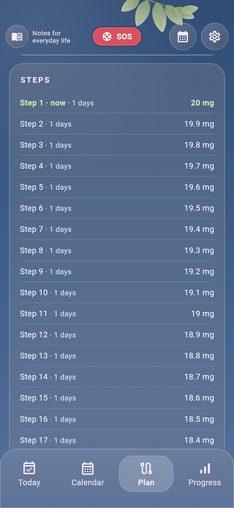
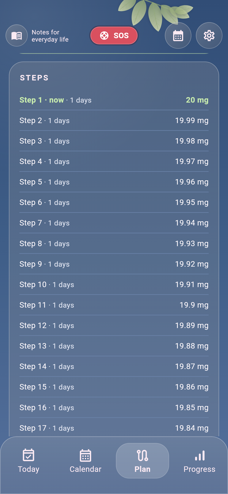
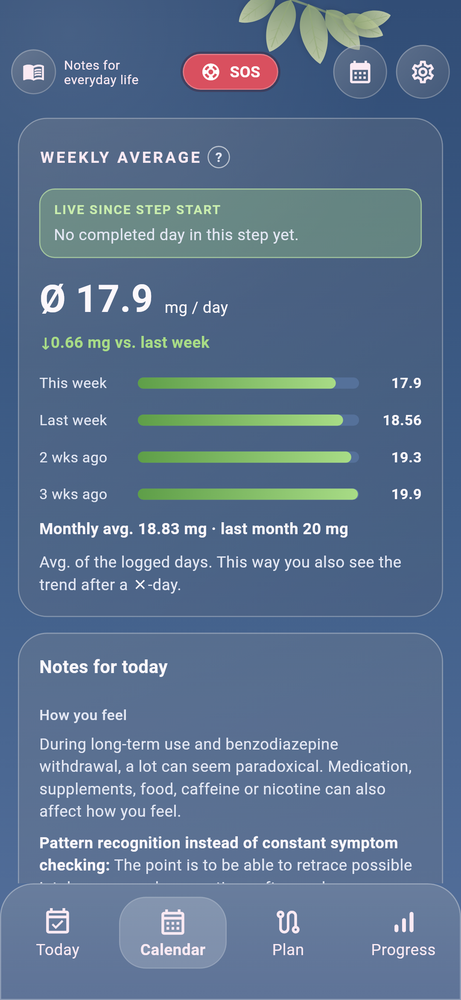

# BeNzoTaPer

**🇬🇧 English** · [🇩🇪 Deutsch](README.de.md)

**A companion for tapering off benzodiazepines – for Android, offline, no account.**

*The app is available in English and German – you choose the language when you first open it and can change it any time under “More”.*

BeNzoTaPer helps you stay on track with your reduction plan: it shows which dose is due each day, counts the days you have managed, shifts the plan when you hold a dose longer, and tells you in good time when your tablet supply is running low. It is meant for everyone who has no close medical support while tapering, and for everyone who simply wants a clear overview.

> **Important:** BeNzoTaPer is a tool for organising and documenting. It does not replace medical advice, makes no diagnoses and does not decide on doses or speed. Agree your plan with a medical professional. Never stop benzodiazepines abruptly after long-term use. In case of a seizure, severe confusion or other acute problems call **112 (Europe) or your local emergency number** (US: 911).

<p align="center">
  
  
  
</p>
<p align="center"><sub>Daily microtapering in 0.1 mg and 0.01 mg steps, and the weekly and monthly average (2 decimals). Test data (diazepam, starting at 20 mg).</sub></p>

---

## Contents
- [The idea behind it](#the-idea-behind-it)
- [What the app can do](#what-the-app-can-do)
- [The rules it calculates by](#the-rules-it-calculates-by)
- [Data and privacy](#data-and-privacy)
- [Installation](#installation)
- [For developers](#for-developers)

---

## The idea behind it

- **Progress instead of symptom hunting.** The focus is on the way you have already come, not on checking for withdrawal symptoms every day.
- **The app never guesses.** A day without an entry stays a question mark. It never counts as “as planned” and never as 0 mg. The only exception is the tablet supply: there it counts with the planned dose, marked as an estimate, until you fill it in – otherwise the supply would run out sooner than the app says.
- **A brake without patronising.** Reducing faster works immediately. Going up or slowing down works too – after a short pause to think.
- **The supply matters.** Doctors sometimes shut the door without warning. A buffer gives you time to find a solution.
- **Simple.** No percentages, no points, no reward games, nothing you *have* to operate.

## What the app can do

### Today (start screen)
- **Intake:** one button, enter the amount, OK. The time is added automatically (and appears like that in the doctor's report). Up to the planned dose you get a tick; above it, a short pause comes first.
- Current step and dose, day x of y, next step, plus the matching **tablet combination** (e.g. from 5 mg and 2 mg tablets).
- **Adjust plan** (change dose, days and steps from today, applies immediately) and **Hold dose** (with or without an end date, the plan shifts automatically).
- Week strip of the last 7 days.
- **Encouragement while holding:** if you hold a dose, you get a short confirmation every few days, but only for clean days. It is meant as prevention, not as a reward.
- **Tablet supply:** enter number × strength, the app converts it to mg and tells you how long it lasts on the current plan (“No exact figure guaranteed – too many variables, but fairly accurate.”). Every intake is deducted automatically, days without an entry count with the planned dose. New purchases can be added. Splittable tablets and solutions (mg/ml) are taken into account.
- A gentle reminder if you haven't made a backup for a while.

### Calendar
- Month view with ticks for every day on plan, numbers when more was taken, the planned dose on upcoming days, **?** for days without an entry, a line at each new step, a sun for good days and a dot for notes.
- **Expected at 0 mg: DD/MM/YYYY.** The date is recalculated every day, because a fixed deadline only creates pressure.
- Tap a day: fill it in (up to 7 days back) or write a note.
- **Weekly average** of the last 4 weeks, a **monthly average** for the whole calendar month (with last month for comparison) and a **live average since the step began** that changes with every entry. All averages show 2 decimals, so even 0.01 mg steps are visible. The average shows how little a single slip changes the big picture.
- **Notes for today** with smileys for how you feel. Meant for spotting patterns later (caffeine, vaping, new medication …), not as a symptom diary.

### Plan
- **Create a plan** as a questionnaire: sections such as “from 10 mg to 5 mg, 1 mg every 14 days”, then slower, and so on. Step size and interval are up to you, including daily steps (down to 0.001 mg). Selectable start date.
- **Import a plan** from PDF, Word (.docx) or text, for example a plan from your doctor.
- Creating and importing are only available while you have no plan of your own. A running plan is changed with **Adjust plan**. To **start over completely**, use More → Reset (like a freshly installed app, make a backup first).
- List of steps with completed, current and upcoming ones.

### Progress
- **Your journey:** from how many mg to how many, days managed, step x of n, expected end.
- **History** as a chart: the plan as a staircase, the 7-day average as a wave, red dots on days above plan.
- **Chart for your doctor:** the same chart as a PDF to share or to view large (“Read”).
- **Progress report for your doctor:** overview, steps, plan changes, weekly averages and a daily log with times, as a PDF (without notes).

### Always within reach
- **SOS** (red, top centre): a 15-minute timer to sit out a wave, a breathing circle (4 seconds in, 6 out), “What you have already achieved” and the emergency number 112 (the German version also lists the German crisis line Telefonseelsorge 0800 111 0 111).
- **Short pause:** if you want to log more than planned, you are first offered a brief stop. After that things continue as normal.
- **Notebook** (top left) for thoughts and everyday things, independent of the calendar.

### Settings (“More”)
- **PIN lock** with a keyword for “Forgot PIN?” (the PIN only locks the interface).
- **Reminder to log** (off by default, time adjustable).
- **Supply notice** as a notification when the supply lasts another 14 and another 7 days (at 10 a.m., once a supply has been entered).
- Save and load an **encrypted backup**, for example for a new phone. It contains your whole tapering history (plan, all entries with times, supply, notes, notebook) but nothing belonging to the app itself: PIN, keyword and settings stay on the device.
- Guide, read all notes again, reset everything.

Without a plan of your own the app shows a **sample plan** so you can see what everything looks like. The sample is never saved.

### Planned
- **Retroactive entries for tapers already under way.** If you are in the middle of tapering (for example with a tally sheet on paper), you should be able to create a plan with a start date in the past and enter your history afterwards or import it as a list. Weekly averages and history are then recalculated automatically. Days added later get a small symbol in the calendar and do not count towards the encouragement.

## The rules it calculates by

| Situation | What happens |
|---|---|
| Day without an entry | Stays **?**. Displays pause, the plan does **not** shift. You can fill in up to 7 days back; older days get “I don't remember”. |
| Took more than planned | It is documented. The next day the planned dose simply applies again. The plan does not shift. |
| Hold dose | The plan pauses and the end moves back by the days held. Without an end date it moves back daily. |
| Reduce faster | Applies immediately (“Adjust plan”). |
| Go up / slow down | Applies immediately, after a short pause. |
| Change the plan | Applies from today. Past days keep the dose that applied on them – in the supply too. |
| Supply | Remaining = counted − intakes since then − planned dose for every day without an entry (an estimate until you fill it in). The range starts from your real position in the plan, including step changes and holds. |
| Goal of 0 mg reached | You keep logging (“Nothing taken today”), so a relapse can be documented too. |

Weekly average and chart only use logged days. A question mark never enters a calculation as 0 mg.

## Data and privacy

- **Everything stays on your phone.** No account, no cloud, no ads, no trackers. The release app has **no internet permission**.
- Android auto backup is **off**, so no health data ends up in a cloud unnoticed.
- The **backup** is a file you share or save yourself. By default it is encrypted with a password of its own (Argon2id + AES-256-GCM). **Forgotten password = backup lost**, there is no back door. Without a password, a readable file is created after a clear warning.
- Permissions: notifications (reminder, supply notice) and “run at startup” so reminders survive a phone restart.

## Installation

BeNzoTaPer is not in the Play Store. You don't need an account.

### With automatic updates (recommended): Obtainium
[Obtainium](https://github.com/ImranR98/Obtainium) is a free app that installs apps straight from GitHub and keeps them up to date.

1. Install Obtainium (download from the Obtainium page or F-Droid).
2. In Obtainium tap **“Add App”** and paste this link: `https://github.com/BrainLab84/BeNzoTaPer`
3. Tap **“Add”** and then **“Install”**. If Obtainium asks for a file, choose the one with **`arm64-v8a`** in its name.

Obtainium will then notify you about new versions.

### Manually
1. On the [Releases](../../releases) page, download the matching APK under “Assets”:
   - `…-arm64-v8a.apk` for almost all phones (about 2017 and newer)
   - `…-armeabi-v7a.apk` only for older phones, if the first one does not install
2. Open the APK. If Android asks, allow installation from this source.

On first start, read the notes, tick the box and tap “Continue”. Updates install over the old version and your data is kept (fixed signing key). Still, make a backup before bigger steps.

---

## For developers

### Structure

```
core/    calculation core in pure Dart (package tapering_core), no UI
app/     Flutter app (Android), only calls the core
tools/   development tools: screenshots, mutation checks, spell check, local APK build
docs/    images for the README
```

**Core (`core/lib/`):** `engine.dart` (`Taper`: state and all rules, the clock can be swapped), `state.dart` (data model, JSON format `strike-v1`), `plan_math.dart` (plan calculation, tablet combination), `plan_parser.dart` (text → steps, German and English), `backup.dart` (encrypted backup), `meldung.dart` (messages as code + values, the text is created in the app), `util.dart`. Only dependency: `cryptography`.

**App (`app/lib/`):** `shell.dart` (tabs, header), `app_state.dart` + `store.dart` (state, atomic saving), one file per area: `kalender`, `eintragen`, `heute`, `plan_reiter`, `plan_neu`, `plan_lesen`, `vorrat`, `verlauf`, `fortschritt`, `tag`, `notizbuch`, `sos`, `pin`, `erinnerung`, `sicherung`, `bericht` (doctor PDF), `lob`. Look: `deko.dart`, `bausteine.dart`. Texts: `texte.dart` (German) and `i18n/` (English, language switching, date and number formats per language). Always add new texts as a pair `tr('deutsch', 'english')`.

The rules live **only in the core**. The UI displays and calls the methods of `Taper`. Code comments and file names are in German.

### Dependencies
Free packages only (F-Droid friendly): `path_provider`, `share_plus`, `file_picker`, `url_launcher`, `read_pdf_text`, `archive`, `flutter_local_notifications`, `timezone`, `pdf`. `pubspec.lock` is checked in. Please don't upgrade packages without testing on a real device or emulator. `path_provider_android` is deliberately pinned to 2.2.23 because the newer JNI variant made the app hang on start on real devices.

### Build and test
Requirement: Flutter stable (tested with 3.50.1).

```bash
cd core && dart pub get && dart analyze && dart test        # core: 96 tests
cd ../app && flutter pub get && flutter analyze && flutter test   # app: 285 tests
```

The test suites cover, among other things:
- **Calculation core:** plans, steps, holding, supply, tablet combinations and import, with frozen reference data
- **Simulations:** random histories over thousands of days, independently recalculated after every day, plus click simulations through the UI
- **UI:** scenarios including restart, layout on small screens with 200 % font size, German and English
- **Mutation checks:** `tools/pruefung/mutation.py` deliberately introduces bugs. All of them are caught by the tests.

More in `core/README.md` and `tools/README.md` (German).

### APK
- **Release (signed with the fixed key):** GitHub workflow `apk-release.yml`, started manually. The signing key exists only in the repository secrets (`TB_KEYSTORE_B64`, `TB_KEYSTORE_PASSWORD`, `TB_KEY_ALIAS`). Version and versionCode are in `app/pubspec.yaml` (e.g. `0.2.1+121`) and must be raised before every release. Separate APKs are built for arm64-v8a and armeabi-v7a (Flutter sets versionCode = 1000 × ABI + versionCode). The workflow aborts if the APK is not signed with the fixed key. With the input `release_tag` (e.g. `v0.2.1`, must match the version) it also creates a GitHub release with both APKs.
- **Test APK:** `TB_TEST=1 flutter build apk --release` builds “BeNzoTaPer Test” (`de.tapering.buddy.test`), which runs next to the real app.
- Other workflows: `core.yml` and `flutter.yml` (analysis + tests), `apk-flutter.yml` (test APK).

### App ID
`de.tapering.buddy` · Version 0.2.4

### License
[GPL-3.0](LICENSE). You may use, change and share the code as long as your version stays open under the GPL-3.0 as well.

---

<p align="center">
  Designed &amp; Developed by Benzo Brain<br>
  © 2026 Benzo Brain
</p>
